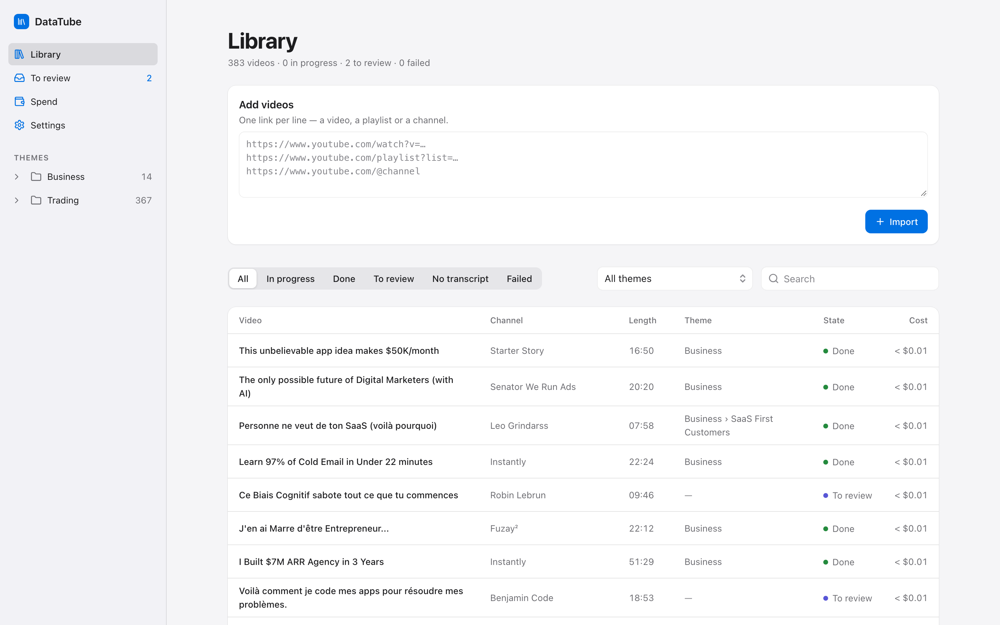
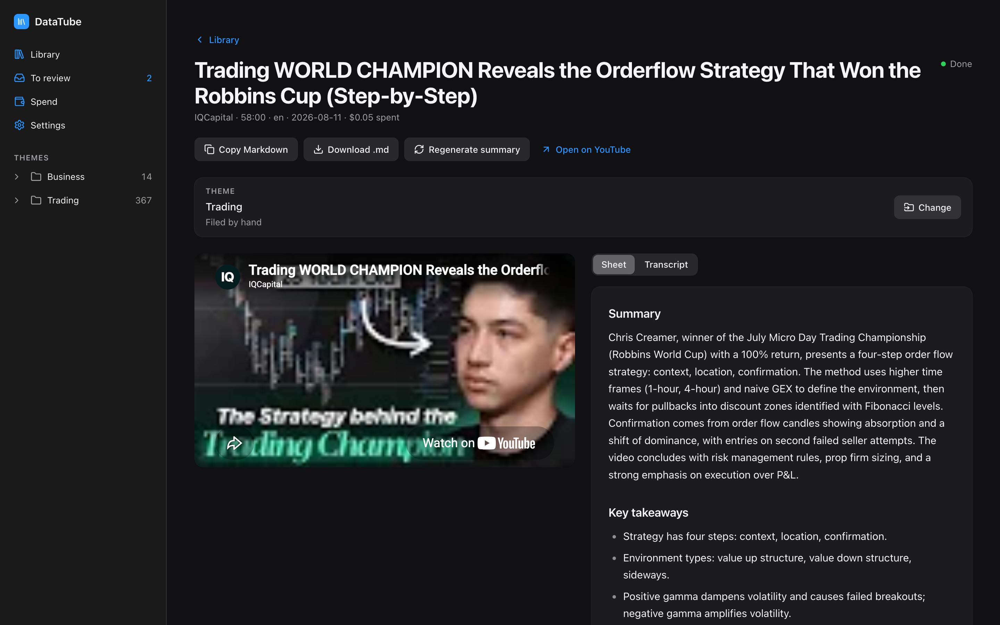
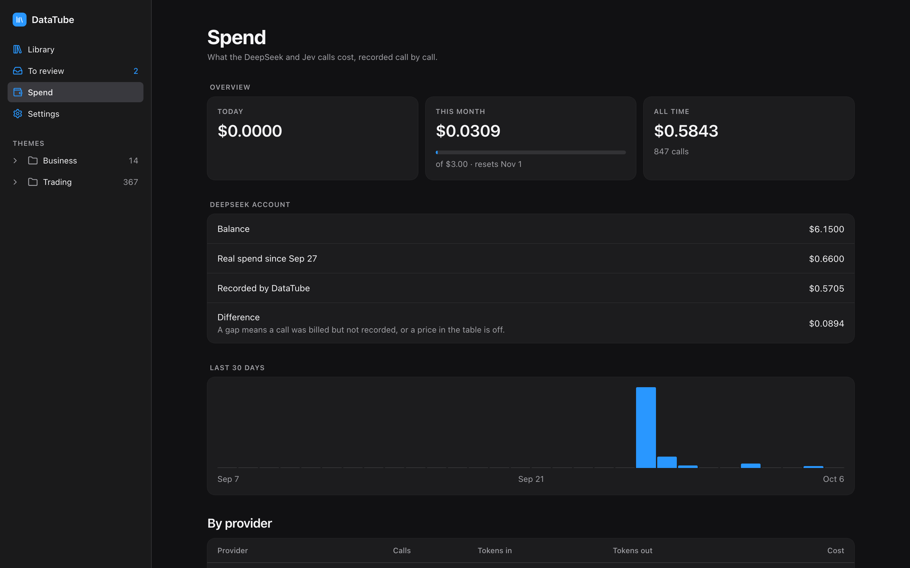
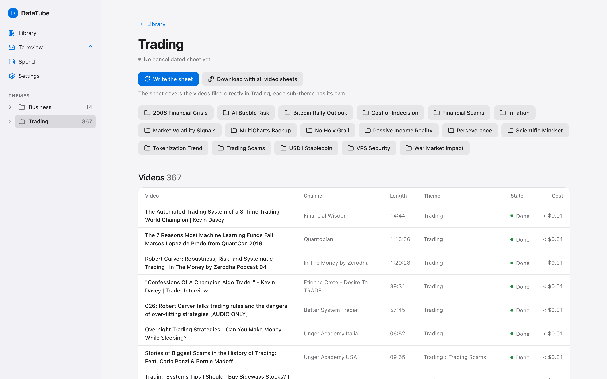
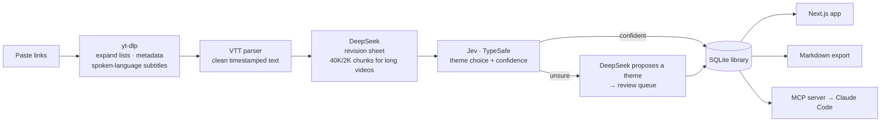

# DataTube

**Turn YouTube videos into condensed knowledge sheets that you — and your AI agents — can actually use.**

Paste a video, a playlist or a whole channel. DataTube fetches each transcript, writes a short revision sheet (summary, key takeaways, step-by-step method), files the video into a theme, and merges a theme's videos into one consolidated sheet. The library is served to Claude Code through an MCP server, so an agent can search it and read it while it works — for example, to turn a trading strategy explained across several videos into a bot.

It runs locally on a Mac: one SQLite file, no cloud, no account.

> **In real use:** 383 videos (72.6 hours) sorted into 20 themes for **$0.58** of API calls in total. A one-hour video becomes a ~3,000-character sheet for about **$0.006**.



| A video and its revision sheet | Spend, reconciled with the real DeepSeek balance |
|---|---|
|  |  |



---

## Features

- **Import anything** — single videos, playlists or entire channels (one link per line). Duplicates are skipped and counted.
- **Faithful transcripts** — always the subtitle track in the language actually spoken, never a machine translation.
- **Revision sheets** — `Summary` · `Key takeaways` · `Method`, in English whatever the video's language. The transcript is the only source; empty sections say *Not in the video*.
- **Long videos** — transcripts over 50K characters are read in 40K parts with a 2K overlap, then merged into one sheet.
- **Automatic sorting** — a calibrated classifier (Jev, TypeSafe) files a video into an existing theme when it is confident enough; otherwise an LLM proposes a theme and the video waits in a review queue.
- **Consolidated theme sheets** — one sheet per theme that also lists where videos disagree, regenerated on demand so cost stays under control.
- **Search** — full-text search across titles, sheets and transcripts (SQLite FTS5).
- **Exports** — every sheet downloads as Markdown with YAML front matter recording where the knowledge came from.
- **MCP server for Claude Code** — `list_themes`, `search`, `get_video_sheet`, `get_theme_sheet`, `get_transcript`.
- **Cost tracking** — every API call is recorded; a Spend page breaks spending down by day, provider and use; a monthly budget holds paid work once it is reached; recorded costs are reconciled with the real DeepSeek balance.

## How it works



Three processes share one SQLite file:

| Process | Role |
|---|---|
| `web` | Next.js 16 app: library, video, theme, review, spend and settings pages; Server Actions validated with zod |
| `worker` | Takes jobs from a SQLite queue one at a time: `fetch` → `summarize` → `classify` |
| `mcp` | Read-only stdio MCP server, started by Claude Code itself |

## Engineering notes

- **Money is never a float.** Costs are integer micro-USD, computed with `BigInt` and rounded once per call, against DeepSeek's peak/off-peak price grid. A `CHECK` constraint rejects anything else in the database. Display truncates, so a spend is never shown larger than it was.
- **A job queue in SQLite.** Jobs are claimed atomically in a single `UPDATE … RETURNING`. Failed steps retry after 30 s and then 2 min before failing with a readable reason. A YouTube rate limit pauses only the YouTube steps for 10 minutes without spending an attempt. Jobs left running by a killed worker are recovered at start, and a lock file prevents a second worker.
- **Nothing invented.** Titles, metadata and sources are written by code, never by the model. The model's output is cut to the expected sections and checked before it is stored. A theme chosen by hand is never overwritten by the classifier, even if it lands mid-classification.
- **Deterministic tests.** 167 Vitest tests. The clock, the `yt-dlp` runner and the HTTP clients are injected, so no test touches the network or real time.
- **Secrets stay local.** API keys live only in `.env.local`. They are redacted from any provider error before it reaches the database, the logs or a page, and Settings only says *set* or *missing*. The app binds to `127.0.0.1` because its actions spend money.
- **Design system.** Apple-like, with light and dark tokens, shared controls and reduced-motion support ([docs/design/design-system.md](docs/design/design-system.md)).

## Tech stack

Next.js 16 (App Router) · React 19 · JavaScript · Tailwind CSS v4 · SQLite (`better-sqlite3`, FTS5) · zod · Vitest · `@modelcontextprotocol/sdk` · yt-dlp · DeepSeek API · TypeSafe Jev API

## Getting started

Requirements: macOS or Linux, Node.js ≥ 22.13, Homebrew.

```bash
brew install yt-dlp deno            # deno is the JS runtime yt-dlp uses for YouTube
npm install
cp .env.example .env.local          # then fill in DEEPSEEK_API_KEY and TYPESAFE_API_KEY
npm run dev                         # the app on http://localhost:3000 and the worker, together
```

### Give the library to Claude Code

```bash
claude mcp add --scope user datatube -- node /absolute/path/to/datatube/mcp/server.mjs
```

Then, in any Claude Code session: *"Use the datatube tools to read my Trading theme sheet and list the entry, stop and exit rules."*

## Project structure

```
app/          Next.js pages, Server Actions and Markdown download routes
components/   UI components
lib/          the core: database, queue, yt-dlp adapter, VTT parser, prompts, pricing, themes, search
worker/       the job worker
mcp/          the read-only MCP server
docs/         spec, implementation plan and design system
```

## Tests

```bash
npm test          # 167 tests
npm run lint
npm run build
```

## Documentation

- [Design spec](docs/superpowers/specs/2026-09-27-datatube-design.md) (in French)
- [Implementation plan](docs/superpowers/plans/2026-09-27-datatube.md) (in French)
- [Design system](docs/design/design-system.md)
